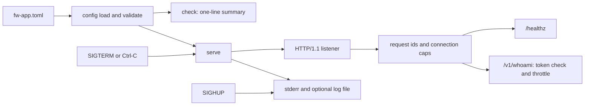

# rust-framework

[](https://github.com/ddproxy/rust-framework/actions/workflows/ci.yml)
[](https://github.com/ddproxy/rust-framework/actions/workflows/codeql.yml)
[](https://scorecard.dev/viewer/?uri=github.com/ddproxy/rust-framework)
[](https://github.com/ddproxy/rust-framework/releases/latest)
[](LICENSE)

Status: preview, version 0.1.0. This is a reference workspace to copy, not a published dependency.

A small, working reference workspace for Rust services. Copy it to start a new project, then rename the `fw` prefix. It builds and tests as shipped. Each crate is a generic version of a pattern from Reiki with the proxy-specific parts removed.

## What and why

This scaffold wires config validation, bearer-token auth with a per-address throttle, a bounded HTTP/1.1 listener, structured logs and an optional terminal dashboard into one binary. The two demo routes are meant to be replaced. The point is a known-good starting tree: the gates are green before you change anything, so a regression is yours, not the scaffold's.



## Install

Install with one line (source build; there is no installer component or published package for this template): `make install PREFIX=$HOME/.local`

Verify first: read `Makefile` and `Cargo.toml`, then run `make check` before installing. The build command is `cargo build --release --locked -p fw-app --features tui`. The manual alternative is to run that command and copy `target/release/fw-app` to a directory on your PATH. `make uninstall` removes the installed binary. `PREFIX=`, `DESTDIR=` and `BINDIR=` override the install paths. See [install](docs/install.md).

## Quickstart (10 minutes)

Requires Rust 1.99 or newer, `curl` and the `fw-app` binary on PATH.

1. Validate the shipped config. This step only reads and checks; it starts nothing.

   ```sh
   fw-app --version
   fw-app check --config fw-app.toml
   # expect: fw-app 0.1.0
   # expect: ok: listen 127.0.0.1:8080, 1 token(s), tls off, log info
   ```

   Expected output:

   ```text
   fw-app 0.1.0
   ok: listen 127.0.0.1:8080, 1 token(s), tls off, log info
   ```

2. Start the listener on loopback and read its health endpoint. The trap stops it when the shell exits.

   ```sh
   fw-app serve --config fw-app.toml >fw-app.log 2>&1 &
   pid=$!
   trap 'kill "$pid" 2>/dev/null || true' EXIT
   for i in $(seq 1 50); do curl -fsS http://127.0.0.1:8080/healthz >/dev/null 2>&1 && break; sleep 0.1; done
   curl -fsS http://127.0.0.1:8080/healthz
   # expect: {"log_write_errors":0,"status":"ok"}
   ```

   Expected output:

   ```text
   {"log_write_errors":0,"status":"ok"}
   ```

3. Proof. Assert the health response and print a named result.

   ```sh
   body=$(curl -fsS http://127.0.0.1:8080/healthz)
   printf '%s\n' "$body"
   case "$body" in
     *'"status":"ok"'*) printf 'PASS: health endpoint\n' ;;
     *) printf 'FAIL: health endpoint\n' >&2; exit 1 ;;
   esac
   # expect: PASS: health endpoint
   ```

   Expected output:

   ```text
   {"log_write_errors":0,"status":"ok"}
   PASS: health endpoint
   ```

The listener enforces auth on `/v1/whoami`: a request without an accepted credential gets 401. No credential value is needed for this quickstart. The full walkthrough is in [quickstart](docs/quickstart.md).

## How it works

`fw-app check` parses and validates the TOML file, probes the optional state directory, loads TLS files when configured and prints one summary line. `fw-app serve` does the same setup, starts logging, binds the listener and runs until SIGTERM or Ctrl-C. Each connection gets a request id and is capped globally and per address. The dashboard is a separate `top` subcommand in builds with the `tui` feature; it shows synthetic data. See [architecture](docs/architecture.md).

## Configuration

Unknown keys are refused at every level. Every validation error names its table. Defaults below are the code defaults for a missing key or table.

| Key | Default | Meaning |
|---|---|---|
| `server.listen` | `127.0.0.1:8080` | Socket address. A non-loopback address requires `[tls]`. |
| `server.max_connections` | `256` | Global open connections, 1 to 100000. |
| `server.max_connections_per_addr` | `16` | Per-address open connections, 1 to `max_connections`. |
| `server.header_read_timeout_secs` | `30` | Seconds allowed for request headers, 1 to 300. |
| `server.request_timeout_secs` | `60` | Seconds allowed for a handler, 1 to 600. Overruns get 408. |
| `tls.cert`, `tls.key` | none | PEM chain and key. Both required when `[tls]` is present. HTTP/1.1 only. |
| `log.level` | `info` | One of `error`, `warn`, `info`, `debug`, `trace`. `RUST_LOG` overrides it in `serve`. |
| `log.format` | `text` | `text` or `json`. |
| `log.stderr` | `true` | Also write to stderr. Always on when no file is set. |
| `log.file` | none | Append-only log path. Created with mode 0640; no symlinks on Unix. |
| `state.dir` | none | Directory created and probed for writability at startup. |
| `auth.throttle` | `true` | Reserve one attempt per address on every auth check. |
| `auth.max_failures` | `10` | Attempts per window, 1 to 1000. |
| `auth.window_secs` | `60` | Throttle window in seconds, 1 to 86400. |
| `auth.tokens` | empty | Per-token tables, each with `name` and `token_sha256`. |
| `auth.tokens[].name` | required | 1 to 64 characters from A-Z, a-z, 0-9, dot, underscore, hyphen. Unique. |
| `auth.tokens[].token_sha256` | required | 64 lowercase hex characters. Unique. The source length is not checked. |

Minimal example (defaults fill the rest):

```toml
# docs-check: parse
[server]
listen = "127.0.0.1:9090"
```

Full example (TLS and token entries are added only when needed; see [configuration](docs/configuration.md)):

```toml
# docs-check: parse
[server]
listen = "127.0.0.1:8080"
max_connections = 256
max_connections_per_addr = 16
header_read_timeout_secs = 30
request_timeout_secs = 60

[log]
level = "info"
format = "text"
stderr = true
# file = "/var/log/fw-app.log"

[state]
dir = "/var/lib/fw-app"

[auth]
throttle = true
max_failures = 10
window_secs = 60
```

TLS is a separate optional table:

```toml
# docs-check: parse
[tls]
cert = "/etc/fw-app/cert.pem"
key = "/etc/fw-app/key.pem"
```

Both examples are parsed by the real validator in the docs check. Token entries are a `[[auth.tokens]]` array of tables with a `name` and a SHA-256 digest; the shipped demo config shows the shape. Describe the digest in prose, never paste a credential or a digest into a ticket.

## Operating it

| Task | Command or action |
|---|---|
| Upgrade | `make install PREFIX=$HOME/.local` (rebuild and replace the binary) |
| Rollback | Install the binary from the previous release archive, or `make uninstall` |
| Backup | Copy `fw-app.toml`, the TLS files and the configured state directory |
| Restore | Put the copies back, then `fw-app check --config fw-app.toml` before serving |
| Logs | stderr, or the append-only file in `log.file`; SIGHUP reopens the file |
| Metrics | `/healthz` returns `status`, `log_write_errors` and `not_after` when TLS is on |
| Health | `fw-app check` before start, `curl -fsS http://127.0.0.1:8080/healthz` while running |

Shutdown drains in-flight requests for up to 10 seconds. See [operations](docs/operations.md) and [troubleshooting](docs/troubleshooting.md) for exact error messages and fixes.

## Security model

Startup refuses an unreadable or oversized config, an unknown key, an insecure TLS key on Unix, an expired certificate and an unwritable state directory. Requests without an accepted credential get 401, and repeated attempts get 429 with a retry hint. Credentials are stored only as digests and compared in constant time against every configured entry. Logging failures do not fail a request; they increment a counter. Non-loopback listeners require TLS. This is a scaffold, not a hardened production service: see [security model](docs/security.md) for trust boundaries and [SECURITY.md](SECURITY.md) for reporting.

## Compatibility matrix

| Item | Last checked |
|---|---|
| Rust 1.99 (declared minimum), workspace edition 2021 | rustc and Cargo 1.100.0 locally |
| Linux, x86_64, musl | `release.yml` target at 0.1.0 |
| Linux, aarch64, musl | `release.yml` target at 0.1.0 |
| macOS, arm64 and x86_64 | `release.yml` targets at 0.1.0 |
| HTTP/1.1 clients, ALPN `http/1.1`, rustls 0.23 with ring | Unit and socket tests on Linux x86_64 |
| Terminal dashboard, ratatui 0.30 and crossterm 0.29 | Tests with the `tui` feature |

No HTTP/2, no client-certificate auth and no Windows key-permission check. Release packaging runs only on github.com.

## Limits and non-goals

- Config files over 64 KiB are refused. Connection, timeout and throttle ranges are listed above.
- The throttle tracks at most 4096 addresses and keys IPv6 by /64. A success does not reset the count.
- Extractors read at most 64 KiB of body; a handler reading a raw body must bound it itself.
- Refused connections get no response and are logged at debug level. Idle keep-alive connections hold a slot until the drain timeout.
- The dashboard shows synthetic data. There is no real feed, no shared state and no horizontal scaling.
- No token rotation, expiry, audit trail or per-route policy beyond the two demo routes.
- Not a library dependency and not a published crate. Copy the tree instead.

Full list: [limits](docs/limits.md).

## Contributing and development

```text
make help                                  # list targets
make build                                 # release build with tui
make check                                 # fmt, clippy, tests (with and without tui), docs
make docs-check                            # quickstart, config examples, CLI drift, links, style
cargo test --locked --workspace
cargo test --locked --workspace --features tui
```

`make check` runs fmt, clippy with warnings denied, tests with and without `tui`, a warnings-denied doc build and `make docs-check`. Commits are terse, imperative and carry no job or personal names. Releases are tagged `v*`; `release.yml` builds four targets, then attaches checksums, a CycloneDX SBOM and build provenance. See [CHANGELOG.md](CHANGELOG.md) and [AGENTS.md](AGENTS.md).

## License and links

MIT. See [LICENSE](LICENSE). Docs: [index](docs/index.md), [security scanning](docs/security-scanning.md), [changelog](CHANGELOG.md).
